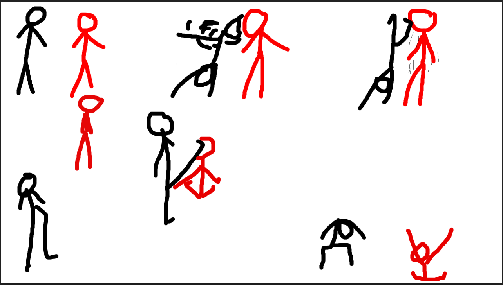

# Reference case: an unnumbered stick-figure fight

The original is a user-supplied drawing included during skill development. It is an example, not a requirement to reproduce this fight in every project.

## Visible evidence

A white page contains black/red figures. Upper left has two standing figures. Upper middle has a leaning black figure with lines near the red figure's upper body. Upper right has black beside red with thin nearby strokes. Center has black with a diagonal leg line toward a low red pose. Lower left has black with a raised leg; bottom has a bent black figure and a low red figure with raised arm lines. Another standing red figure is left of center.

There are no panel numbers, connecting arrows, times, floor, or stated personality. Limb assignment at overlaps is ambiguous. Strokes may indicate motion, but speed/direction were not measured. Black=A and red=B is a useful identity convention for this case.

## Plausible reconstruction, not a fact of the drawing

One interpretation is encounter → upper-body interaction → A's support change → whole-leg strike → B loses balance → low B ending and A recovery. Another is upper-phase block/evasion followed by a leg counter. Isolated lower figures may represent preparation or recovery. Do not claim an unambiguous uppercut followed by a roundhouse.

Establish personalities before new acting: “How do A and B behave and what do they want? Is A calm/precise and B bold/impulsive, or something else?” No traits are inferred from colors.

## Author example after explicit delegation

An illustrative card only: A is calm/economical and wants to stop pressure. B is confident, rushes for initiative, and becomes angry after a mistake. A user's project may specify the reverse. Assume a rigid R6 Blender film at 30 effective FPS lasting about five seconds. These are author choices absent from the drawing.

| Seconds from start | Beat/pose | Cause/contact | Camera, effects, audio |
|---|---|---|---|
| 0–0.7 | Assess distance; stable A, forward B | Established floor/support | Wide three-quarter, quiet ambience, no shake |
| 0.7–1.35 | Short entry/upper interaction | Hypothesis: A redirects B's attack; choose actual block point in layout | Both heads/contact visible, cloth/short whoosh, restrained contact |
| 1.35–2.05 | B overcommits; A transfers support/prepares leg | Recovery connects drawn extremes | Small motivated following; effects disabled for mechanics |
| 2.05–2.30 | Fast leg drive, provisional contact near 2.2 s | Real whole-leg reach and B torso direction | Short trail, approach sound, one main impact |
| 2.30–3.3 | B reacts/travels/falls | Established force and support loss | Brief post-contact shake without hiding first reaction |
| 3.3–4.0 | B contacts ground | Direction/height follow chosen root path | Floor-born dust, body fall, later small debris cues |
| 4.0–5.0 | A regains control; B assesses error | Goals/change visible in final pose | Camera settles, tails decay, brief final hold |

Literal preservation of every drawn pose is unnecessary when poses repeat a beat, but explicit user preferences take priority. The contact time is provisional: place the final marker from evaluated geometry, then attach effects/audio.

## Review reconstruction

Neutral playback must explain initiative, force transfer, support loss, and recovery. R6 legs remain whole segments; do not add knees to match a line. A flash cannot explain an unclear upper contact. Minecraft uses its agreed rigid/bending profile.

From final camera, inspect negative space between A's leg and B's torso before contact, then reaction. Trail paths follow verified 3D endpoints rather than an unattached page diagonal. Main sound transient aligns with contact; ground impact is separate. A's final behavior expresses character without requiring a victory pose.
